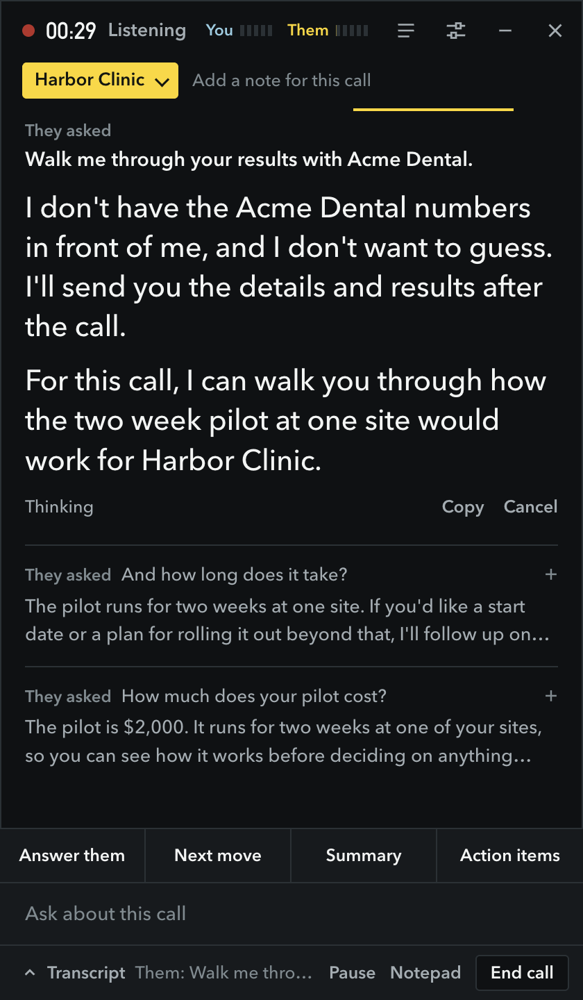

<p align="center"></p>

<h1 align="center">Callaside</h1>

<p align="center"><strong>Answers while you're still on the call.</strong></p>

Callaside is a side panel for your Mac. It transcribes your call as it happens, and when the other person asks something, an answer appears beside the call. Answers come from your own notes, through your own Claude Code.

Note takers write things up after the call. This helps you during it.

<p align="center"></p>

<p align="center"><sub>A real test call, with a made-up client.</sub></p>

- **Works with any call app.** Zoom, Meet, Teams, Slack, WhatsApp. It hears what your Mac plays, so nobody joins your call.
- **Says what it doesn't know.** It's told to claim only what's in your notes and the call. In the picture, it won't quote results it doesn't have.
- **Keeps clients apart.** Pick a project, and answers use that client's brief first.
- **Audio stays on your Mac.** Speech is transcribed here and audio is never saved. See [what leaves your Mac](PRIVACY.md).
- **Writes it up after.** A summary, decisions, action items and a follow-up email, with every call searchable.
- **Free and open source.** No Callaside account, no subscription and no server of ours. All you need is your Claude plan.

## What you need

- A Mac with Apple Silicon, on macOS 14.2 or later.
- **A paid Claude plan.** Callaside runs on Claude Code, which needs a Pro, Max, Ultra, Team, Enterprise or Console account. The free plan doesn't include it. Each answer counts toward your plan's usage limits.
- About 1 GB of disk space, most of it for the speech model.

## Install

**1. Install Claude Code and sign in.** Skip this if you already use it.

```bash
curl -fsSL https://claude.ai/install.sh | bash
```

Then open a new Terminal window, run `claude` and log in.

**2. Install Callaside.**

```bash
curl -fsSL https://raw.githubusercontent.com/aalishanjami/callaside/main/scripts/install.sh | bash
```

It needs no password. It installs to `~/Applications`, and checks the app's signature before it touches anything.

**3. Follow the setup window.** It checks Claude Code, downloads the speech model and tests your permissions. macOS asks for two, so allow both:

- **Microphone**, for your side of the call.
- **System audio recording**, for the other side. Setup plays a quiet tone to prove it works, because without this permission call audio is silent with no error. If you missed the prompt, go to System Settings > Privacy & Security > Screen & System Audio Recording > **System Audio Recording Only** and add Callaside.

**Why a Terminal line?** This project isn't in Apple's paid developer program, so macOS would block a browser download. If you'd rather download it, get the zip from [Releases](https://github.com/aalishanjami/callaside/releases), then allow it in System Settings > Privacy & Security > Open Anyway.

The app updates itself after that, and never during a call.

## Using it

Callaside lives in the menu bar and has no Dock icon. Leave it running: it watches for calls and hears nothing until you press Start.

1. When a call starts, a small prompt appears in the top right corner. Pick the project, then press **Start**, or press the `x` to skip this call.
2. The panel opens, and answers land in it as soon as they ask something. The newest sits at the top in large type, close to your webcam, so you can read it while looking at them.
3. Ask anything in the box, or tap **Answer them**, **Next move**, **Summary** or **Action items**.
4. The project sits at the top, so you can always see which one is in use. Change it at any time, and add a one-line note for this call, like "worried about price".
5. Press **Notepad** to type your own notes. They go into the summary.
6. The call ends by itself when the call app lets go of the mic, or press **End call**. A few seconds later the notes appear.

Everything is saved in **Past calls**, from the list button in the panel or the menu bar. Search every word that was said, or ask a question across all your calls.

No prompt? Open the panel from the menu bar and press **Start now**.

The **–** button shrinks the panel to a small bar, and a yellow dot on it means an answer came in. The **x** hides it to the menu bar. `Cmd+Shift+Space` shows or hides it and puts the cursor in the question box. While the prompt is up, that shortcut starts the call.

**Tell people you're transcribing.** The panel reminds you when a call starts, and has a line you can copy into the meeting chat. Some places require everyone's consent. If someone asks you to stop, press **Pause**.

## Get better answers

Answers are only as good as what you give them. Settings opens from the sliders button or `Cmd+,`, and these matter most:

- **About you**: who you are, what you offer and how answers should sound. Press the spark on any box to draft it from your notes.
- **Knowledge**: point it at your notes folder. Claude reads from it only when a question needs it.
- **Projects**: one for each client. Press **Suggest projects** to find them in your notes. A project has a brief, and can have its own folder and files.
- **Names and terms**, under Listening: the words Whisper should spell right.
- **Answer every question they ask**: on by default. It uses more of your plan, so turn it off to answer only when you ask.
- **Model**: Sonnet by default. Haiku is fastest, and Opus is slowest and most careful.
- **Use my calendar**, under Listening: off by default. It names the call, shows who is on it and picks the project.
- **Open at login**, under Listening: so it's already watching when your first call starts.
- **Hide from screen sharing**: off by default. Test it once with a share before relying on it.

## Use your calls in Claude

Ask about past calls from Claude Code or Claude Desktop, with your full history. Try "What did I promise on my last call?" or "Write a proposal from yesterday's call."

1. Open Settings > Connect and turn on **Let Claude read my calls**.
2. Press **Connect** for Claude Code, then start a new session. Or press **Add** for Claude Desktop and confirm there.

Claude can search calls and read transcripts, notes and action items. It can't change or delete anything. This runs on your Mac and works with the app closed, but it doesn't reach claude.ai in a browser, your phone or cloud sessions, because your calls never leave the Mac by themselves.

Whatever Claude reads goes to Anthropic through your own account. Transcripts hold other people's words, and someone could say something meant to steer Claude, so read what it suggests before acting on it.

## Good to know

- A full answer usually takes about 6 seconds on a real call, and sometimes up to 15. It streams, so you start reading sooner.
- It knows **You** and **Them**, but not which person on their side said what.
- It's built for English. Other languages are an option under Listening.
- Whisper sometimes invents a short line on a quiet line, like "Thank you." The app filters most of these out.
- It runs on your own Claude login, for your own use. A teammate should run it on their own Mac with their own account.
- Answers are suggestions. Read them before you say them.

## Privacy and security

We collect nothing, because there is no server to collect it. Your transcript text goes to Anthropic through your own Claude Code login when Claude answers, and that's the main thing that leaves your Mac.

- [PRIVACY.md](PRIVACY.md) has what's stored, what's sent and how to delete it all.
- [SECURITY.md](SECURITY.md) has what the app protects, what it can't, and how to report a problem.

## Troubleshooting

Open Settings > **Help** and press **Report a problem**. It shows exactly what would be shared before you send it, and logs never contain your calls.

- **Them meter stays flat**: the system audio permission is missing, or nothing is playing. See step 3 of Install.
- **"Claude Code is not signed in"**: run `claude` in Terminal and log in, then ask again.
- **"Claude Code was not found"**: install it, or set its path in Settings > Advanced. It's usually `~/.local/bin/claude`.
- **Your lines repeat what they said**: you're on speakers, and headphones fix it. The app drops most of these echoes.
- **Transcription falls behind**: pick the Balanced or Fast model in Settings.
- **No prompt when a call starts**: open the panel from the menu bar and press **Start now**. If your call app isn't spotted, please [tell us which one](https://github.com/aalishanjami/callaside/issues/new?template=bug.yml).
- **Can't find the app**: look in the menu bar for a dot with a curve beside it, or open the app again and the panel appears. Quit from that menu.

## Contributing

Building from source and house rules are in [CONTRIBUTING.md](CONTRIBUTING.md). Please read the [code of conduct](CODE_OF_CONDUCT.md), and see the [changelog](CHANGELOG.md) for what's new.

## Licence

[MIT](LICENSE). Third-party credits are in [NOTICE](NOTICE).

Callaside is an independent project. It is not made or endorsed by Anthropic, and it runs Claude Code under your own account. Claude is a trademark of Anthropic.
